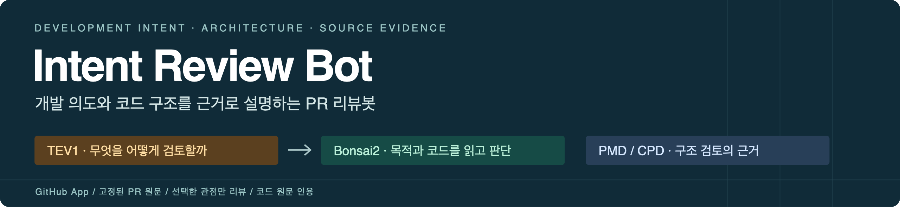
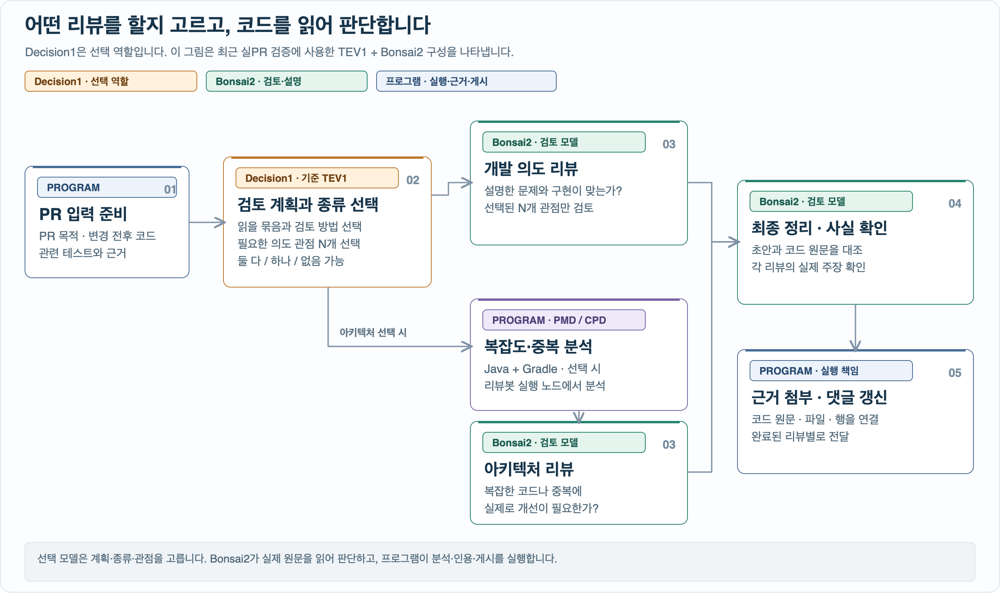
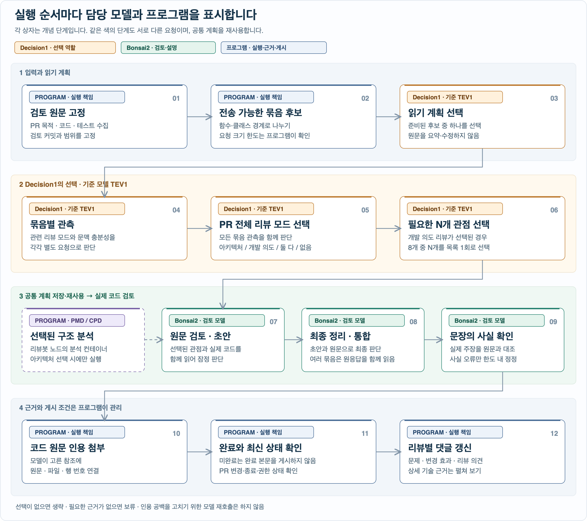
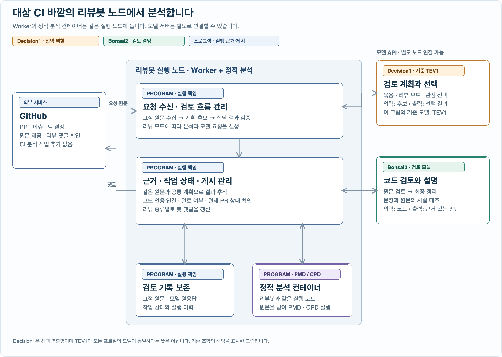

[SVG 원본 보기](docs/assets/readme-hero.svg)

# Intent Review Bot

**PR에서 설명한 목적이 코드에 반영됐는지, 바뀐 구조에 검토할 문제가 있는지 함께 살펴봅니다.**

선택 모델이 검토 범위와 방법을 고르고, Bonsai2가 고정된 코드 원문을 읽어 판단합니다.<br/>
Java + Gradle의 구조 검토에는 PMD·CPD 분석을 근거로 연결하고, 개발자가 이해할 수 있는 설명과 코드 인용을 PR에 남깁니다.

**대상 프로젝트의 CI에 분석 작업을 추가하지 않습니다. 리뷰봇 실행 노드에서 PR 원문을 받아 독립적으로 분석합니다.**

`GitHub App` · `TEV1 + Bonsai2` · `개발 의도 리뷰` · `아키텍처 리뷰` · `PMD / CPD`

[어떤 점이 다른가](#difference) · [리뷰 기능](#reviews) · [모델과 실행 흐름](#runtime) · [시스템 구조](#architecture) · [결과 예시](#output) · [시작하기](#start)


<br/>

<a id="difference"></a>

## 🎯 어떤 점이 다른가

**개발 의도와 구조적 영향을 각각의 검토 방법으로 다루고, 필요한 검토만 계획해서 실행하는 봇입니다.**

Codex 같은 범용 PR 리뷰의 대표적인 질문은 “이 변경에 중요한 버그나 위험이 있는가?”입니다.
이 프로젝트는 다음 두 질문을 별도의 리뷰 흐름으로 다룹니다.

- 설명한 문제를 실제로 해결하는가?
- 변경된 코드의 책임·의존·복잡도·중복을 구조적으로 검토할 필요가 있는가?

**그림의 `Decision1`은 선택 담당 역할이며, 이 README는 최근 실PR 검증의 `TEV1 + Bonsai2` 구성을 기준으로 표시합니다.** 다른 프로필의 선택 모델이 TEV1과 동일한 모델이라는 뜻은 아닙니다.



[SVG 원본 보기](docs/assets/review-responsibilities.svg)

| 비교할 지점 | Codex GitHub 코드 리뷰의 공식 기본 흐름 | 이 프로젝트가 명시적으로 제공하는 흐름 |
|---|---|---|
| 검토 초점 | PR diff와 저장소 지침을 바탕으로 중요한 문제 검토 | 개발 의도와 아키텍처 검토를 구분하고 필요한 모드 선택 |
| 팀의 기준 반영 | `AGENTS.md`의 리뷰 규칙 | 저장소별 리뷰 지시·댓글 양식과 고정된 검토 관점 |
| 검토 절차의 구성 | Codex의 코드 리뷰 기능 사용 | TEV1의 계획·선택과 Bonsai2의 원문 검토를 분리해 운영 |
| 구조 분석의 연결 | 제품·팀의 별도 도구 구성에 따라 달라짐 | 선택된 Java + Gradle 아키텍처 리뷰에 PMD·CPD 결과 연결 |

Codex도 저장소별 규칙과 문맥을 활용할 수 있습니다. 이 표는 우열이나 기능 부재를 단정하는 비교가 아니라, **이 프로젝트가 직접 구성해 둔 리뷰 절차**를 설명합니다. 비교 기준은 OpenAI의 [GitHub 코드 리뷰 안내](https://learn.chatgpt.com/docs/third-party/github)와 [저장소별 리뷰 규칙 안내](https://developers.openai.com/blog/custom-code-review-rules-for-codex)입니다.

<br/>

<a id="reviews"></a>

## 🔎 두 가지 리뷰 기능

### 개발 의도 리뷰

**무엇을 고치려는 변경인지와 실제 구현이 연결되는지 검토합니다.**

PR 설명·연결된 이슈와 변경 전후 코드·테스트를 함께 읽습니다. 테스트 코드를 읽었다는 사실을 테스트가 통과했다는 주장으로 바꾸지 않습니다.
고정된 8개 관점 중 TEV1이 필요한 N개를 **한 번의 요청으로 선택**하고, 초안·최종 결과·사실 확인·댓글 모두 선택된 N개만 다룹니다.

<details>
<summary>선택 가능한 8개 관점</summary>

| 관점 | 확인하는 질문 |
|---|---|
| 문제와 성공 기준 | 어떤 상황이 문제이며 무엇이 달라져야 해결인가? |
| 목적과 변경의 대응 | 목적에 필요한 구현이 있고, 주요 변경의 이유가 설명되는가? |
| 수단의 적합성 | 이 구현 방식이 의도한 문제에 작용하는가? |
| 결과까지의 연결 | 변경의 효과가 사용자·호출자·후속 처리까지 도달하는가? |
| 달성 범위 | 의도한 대상과 조건을 빠짐없이, 과하지 않게 다루는가? |
| 보존 조건 | 유지해야 할 동작과 변경하지 않기로 한 경계를 지키는가? |
| 전제와 절충 | 필요한 가정과 감수하는 비용이 목적에 맞는가? |
| 검증 근거 | 제공된 코드와 테스트가 목적 달성 주장을 뒷받침하는가? |

선택되지 않은 관점의 결과를 억지로 작성하지 않습니다. 선택된 관점에서도 근거가 부족하면 그 한계를 표시합니다.

</details>

### 아키텍처 리뷰

**코드 복잡도와 중복 분석 결과를 바탕으로, 구조를 개선할 필요가 있는지 검토합니다.**

- **PMD:** 코드 복잡도, 한 클래스에 기능이 몰린 정도 등을 분석합니다.
- **CPD:** 코드가 중복되는 위치와 관계를 제공합니다.
- **Bonsai2:** 분석 대상 코드의 변경 전후를 읽고, 실제 문제·개선 제안·확인 질문을 구분합니다.

**Java + Gradle은 분석 후보가 되는 조건입니다. 해당 조건만으로 PMD·CPD를 항상 실행하지 않습니다.**
TEV1이 아키텍처 검토가 필요하다고 선택한 경우에 분석하고, Maven 모듈은 이 모드의 지원 대상에서 제외합니다. 개발 의도 리뷰는 Java·Gradle 여부와 독립적입니다.

분석 수치가 높거나 중복이 있다는 이유만으로 결함이나 공통 코드 추출을 요구하지 않습니다. 개발자에게 알릴 내용은 원문 근거와 함께 선별합니다.

### 정적 분석은 어디에서 실행하나

**리뷰봇 Worker가 실행되는 Linux 노드의 격리된 분석 컨테이너에서 수행합니다.** 대상 저장소의 CI 실행 머신에 분석을 맡기는 방식이 아닙니다.

1. 리뷰봇이 GitHub에서 고정된 PR 커밋의 원문을 수집합니다.
2. 아키텍처 리뷰가 선택되면, 같은 노드의 컨테이너에서 PMD·CPD를 실행합니다.
3. 분석 결과와 코드 원문을 모델 검토에 연결하고, 리뷰봇이 PR 댓글로 전달합니다.

대상 프로젝트에 PMD·CPD용 Gradle 플러그인·태스크나 CI 작업을 추가할 필요가 없습니다. 대상 프로젝트의 Gradle 빌드·테스트 스크립트도 실행하지 않습니다. 기존 CI와 별개로 동작하는 **독립적인 PR 분석 서비스**입니다.

| 구성 요소 | 실행 위치 |
|---|---|
| 리뷰봇 Worker와 PMD·CPD 컨테이너 | 같은 리뷰봇 실행 노드 |
| TEV1·Bonsai2 모델 서버 | 같은 노드 또는 별도로 연결한 모델 서버 |
| 대상 프로젝트의 기존 CI | 리뷰봇 분석과 독립적으로 유지 |

<br/>

<a id="runtime"></a>

## 🧠 TEV1과 Bonsai2는 언제 쓰이나

**TEV1은 검토 계획과 선택을 맡고, Bonsai2는 코드를 읽어 설명과 판단을 만듭니다. 프로그램은 원문·크기 한도·인용·게시 조건을 관리합니다.**

| 단계 | 담당 | 하는 일 |
|---|---|---|
| 입력 준비 | 프로그램 | PR의 검토 커밋과 수집 범위를 고정하고, 원문을 유지하는 묶음 후보 생성 |
| 읽기 계획 | TEV1 | 프로그램이 제시한 유효한 묶음 계획 중 하나 선택 |
| 묶음 관측 | TEV1 | 각 묶음에 관련된 리뷰 모드와 문맥 충분성을 각각 판단 |
| 전체 모드 선택 | TEV1 | 관측 결과를 모아 PR 전체의 아키텍처 리뷰·개발 의도 리뷰 수행 여부 선택 |
| 의도 관점 선택 | TEV1 | 개발 의도 리뷰가 선택되면 8개 중 필요한 N개를 한 번에 선택 |
| 분석·초안 | PMD·CPD / Bonsai2 | 선택된 구조 분석을 수행하고, 원문을 읽어 리뷰 초안 작성 |
| 최종 정리·통합 | Bonsai2 | 초안과 원문을 대조해 최종 리뷰 작성. 여러 묶음이면 원래 응답과 근거를 함께 읽어 통합 |
| 사실 확인 | Bonsai2 / TEV1 / 프로그램 | Bonsai2는 문장과 원문을 대조. 필요한 PMD 지표 의미는 TEV1이 분류하고 프로그램이 고정 정의와 비교 |
| 결과 전달 | 프로그램 | 선택한 코드 참조에 원문·파일·행을 붙이고, 완료된 리뷰를 게시 |

아래 주황색 **Decision1 · 기준 TEV1** 상자들은 **서로 다른 판단 단계**입니다. 모든 판단을 한 요청에 몰아넣지 않습니다. 초기 계획은 이후 리뷰에서 재사용하며, 분석 근거나 요청 크기 때문에 필요할 때만 수정합니다.



[SVG 원본 보기](docs/assets/review-runtime.svg)

두 리뷰를 함께 선택할 수 있으며 현재 Worker는 선택된 모드를 순서대로 처리합니다. 분기선은 검토 경로를 나타내며, 한 PR 안의 모델 호출을 모두 병렬 실행한다는 뜻은 아닙니다.

**큰 입력은 원문을 유지한 채 나눕니다.** 프로그램이 함수·클래스 같은 코드 경계를 이용해 전송 가능한 후보를 만들고 TEV1이 선택합니다. 이전 모델 응답도 그대로 보존합니다. 필요한 근거를 끝까지 처리하지 못하면 완료된 리뷰로 게시하지 않습니다.

**인용은 프로그램이 붙입니다.** 모델이 제공된 코드 참조를 고르면 원문 코드와 파일·행 번호를 연결합니다. 인용의 공백이나 범위를 고치기 위해 모델끼리 재작성·재검증을 반복하지 않습니다. 실제 내용의 사실 오류에 대한 확인은 유지합니다.

<br/>

<a id="architecture"></a>

## 🏛️ 시스템 디자인과 아키텍처

대상 프로젝트의 CI 바깥에 **리뷰봇 실행 노드**를 둡니다. Worker와 정적 분석 컨테이너는 이 노드에서 함께 실행하고, 모델 서버는 별도로 연결할 수 있습니다. GitHub 연결, 검토 규칙, 모델 실행, 정적 분석은 책임별로 분리합니다. 선택 모델과 Bonsai2가 GitHub 댓글이나 분석 컨테이너를 직접 조작하지 않고, **리뷰 서비스가 모델의 선택을 검증해 실행**합니다.



[SVG 원본 보기](docs/assets/review-system.svg)

| 설계 원칙 | 사용자에게 의미하는 것 |
|---|---|
| 프로젝트 CI와 독립 | 대상 CI에 분석 작업을 추가하지 않고 리뷰봇 노드에서 실행 |
| 같은 원문으로 검토 | 어느 커밋과 어떤 코드에 대한 판단인지 확인 가능 |
| 검토 규칙과 외부 연결 분리 | GitHub·모델·분석 도구 연결이 바뀌어도 검토 책임을 구분해 유지 |
| 작업과 모델 요청량 관리 | 여러 PR 요청이 들어와도 대기·취소·현재 실행 범위를 추적 |
| 리뷰별 완료·게시 판단 | 한 리뷰가 실패했다고 다른 리뷰의 정상 결과를 버리지 않음 |
| 코드·분석·모델 결과 구분 | 분석 결과나 코드 인용만으로 판단의 정확성을 보장하지 않음 |

PR이 변경되거나 닫히면 게시 시점의 최신 상태를 확인합니다. 새 실행마다 댓글을 늘리는 대신 리뷰 종류별로 기존 봇 댓글을 갱신합니다. 병합 승인과 최종 개발 판단은 사람에게 남깁니다.

<br/>

<a id="output"></a>

## 💬 개발자는 무엇을 받나

본문은 **문제 상황 → 변경 효과 → 리뷰 의견** 순서로 읽을 수 있게 구성합니다. 함수·상수 이름, 분석 세부 결과, 코드 원문은 필요한 곳에서 펼쳐 볼 수 있습니다.

> ### 개발 의도 리뷰
> **판단: 이번 변경은 PR에서 설명한 문제를 해결하는 방향과 맞습니다.**
>
> **문제:** 메뉴바에서 한도가 없는 설정이 `$0`으로 보일 수 있었습니다.
>
> **변경 효과:** 비용 정보를 평소 방식으로 가져오지 못할 때도 무제한 한도를 `∞`로 유지합니다.
>
> **리뷰 의견:** 제공된 코드와 추가된 테스트는 이 목적에 맞게 작성돼 있습니다. 선택된 검토 관점에서는 추가 수정을 요청할 사항을 찾지 못했습니다.
>
> **상세 근거:** 검토한 관점 · 판단 조건 · 파일과 행 번호 · 실제 코드 인용

위 예시는 [실제로 게시한 PR #5 리뷰](https://github.com/pureliture/openai-compatible-bridge/pull/5#issuecomment-6310551402)를 짧게 정리한 것입니다. 이번 실행은 **TEV1 5회 + Bonsai2 3회, 총 5분 7초**였으며, 관점 선택 1회로 1개 관점을 검토했습니다. 이 수치는 해당 입력의 실행 기록이며 다른 PR의 소요시간이나 리뷰 품질을 보장하지 않습니다.

팀이 원하는 설명 기준과 댓글 양식은 저장소 기본 브랜치의 설정 파일에서 변경할 수 있습니다. **팀별 리뷰·설명 지시와 양식은 다음 요청부터 서비스 재시작 없이 적용**됩니다. 모드 선택·실행 권한·근거 검증 규칙은 앱이 관리합니다. 자세한 범위는 [저장소별 리뷰 지시와 댓글 양식](docs/repository-review-settings.md)을 참고하세요.

<br/>

<a id="start"></a>

## 🚀 시작하기

### 실행 도구 준비

Python 3.11 이상과 uv가 필요합니다.

```bash
git clone https://github.com/pureliture/intent-review-bot.git
cd intent-review-bot
uv sync --locked
uv run review-bot --help
```

위 명령은 실행 도구를 준비합니다. 실제 리뷰에는 모델 서버 또는 명시적으로 선택한 모델 연결 설정이 필요합니다.

### 사용할 방식 선택

| 방식 | 적합한 상황 | 다음 문서 |
|---|---|---|
| GitHub App | PR 요청을 받아 봇 댓글로 리뷰 제공 | [서비스와 컨테이너 운영](docs/intent-api-deployment.md) |
| 고정 입력 평가 | 수집된 PR 원문으로 비공개 리뷰 실행 | [운영·설정·실행 참고](docs/runtime-reference.md#private-shared-partition-evaluation) |
| 저장소별 맞춤 설정 | 팀의 리뷰 기준·설명·댓글 양식 변경 | [저장소별 설정](docs/repository-review-settings.md) |

기준 모델 조합은 **TEV1 + Bonsai2**이며, 다른 모델 프로필의 연결 범위와 실행 조건은 [모델·운영 참고](docs/runtime-reference.md#local-llamacpp-explicit-opt-in)에 정리돼 있습니다.
아키텍처 리뷰의 PMD·CPD 실행에는 지원되는 Linux 격리 환경이 추가로 필요합니다.

<br/>

<a id="status"></a>

## 📍 현재 범위와 확인된 상태

- **구현된 흐름:** 공통 계획, 선택한 관점만 리뷰, Java + Gradle 아키텍처 분석 연계, 원문 인용, 사실 확인, 저장소별 설정과 댓글 렌더링.
- **실제 확인:** TEV1·Bonsai2의 고정 PR 개발 의도 리뷰 완료와 GitHub App 작성자 댓글 갱신. 위 PR #5 게시는 사용자의 명시 요청에 따른 병합 PR 댓글 갱신입니다.
- **별도 확인이 필요한 범위:** 최신 변경 기준의 대형 PR 검토 품질·동시 부하·장애 복구·열린 PR의 자동 게시 전체 경로.

기능 구현, 자동화된 검증, 실제 모델의 리뷰 품질, 현재 배포 상태는 구분합니다. 과거 측정·시행착오·세부 실행 조건은 본문의 기능 설명 대신 아래 문서에서 확인할 수 있습니다.

## 📚 더 알아보기

| 문서 | 내용 |
|---|---|
| [운영·설정·실행 참고](docs/runtime-reference.md) | 기존 README의 세부 설정, 실행 명령, 모델 프로필, 과거 실행 기록 |
| [서비스와 컨테이너 운영](docs/intent-api-deployment.md) | API와 서비스 실행·배포 구성 |
| [저장소별 리뷰 지시와 댓글 양식](docs/repository-review-settings.md) | 배포 없이 변경하는 팀별 지시와 표시 양식 |
| [사실 확인과 재작성](docs/review-fact-verification.md) | 사실 대조·원문 전달·정정 범위 |
| [독립적인 개발 의도 리뷰](docs/intent-review-single-run.md) | 개별 평가 파이프라인의 실행 계약 |
| [검증 이력](milestones.md) | 소스 버전별 구현·검증 기록 |
