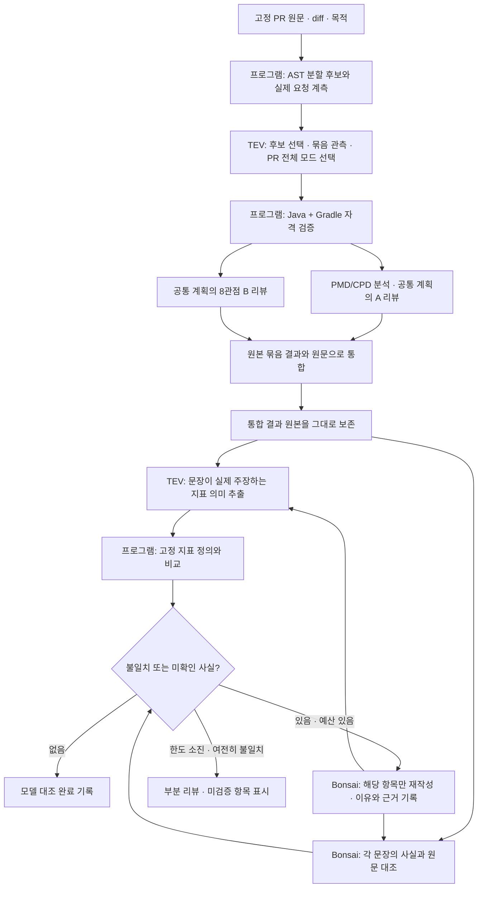

# 사실 검토와 재작성

2026-10-21 사용자가 추가 승인한 공통 A/B 단계다. 기존 초기 계획·원문 분할·모드 선택·관점 리뷰·통합을 수행한 뒤, 최종 문장의 사실 오류를 검사하고 오류 항목을 재작성한다. PMD 리뷰와 의도 리뷰에 같은 단계가 적용된다.

## 입력과 검사의 경계

프로그램이 요약, 발견사항, 8관점, 질문에 안정적인 항목 ID를 부여한다. 각 항목의 원문 전체와 모든 `statement`, `reasoning`, `failure_condition`을 검사한다. 항목이나 긴 필드를 선별적으로 생략하지 않는다.

- **지표 정의:** TCC, ATFD, WMC, NPath, CognitiveComplexity의 의미를 PMD 7.3.0 기준으로 고정한다. [버전이 고정된 JavaMetrics 원문](https://github.com/pmd/pmd/blob/pmd_releases/7.3.0/pmd-java/src/main/java/net/sourceforge/pmd/lang/java/metrics/JavaMetrics.java)을 참조한다. 실제 측정값과 분석 한계는 이번 실행의 분석 대상 기록에서 제공한다.
- **TEV의 역할:** 정의를 맞히게 하지 않고, 리뷰 문장이 그 지표로 무엇을 주장하는지 지표별 선택지로 추출한다. 예를 들어 “TCC가 낮아 결합도가 심각하지 않다”는 `coupling`이다. 프로그램이 TCC의 정의인 `cohesion`과 비교해 불일치를 기록한다. 추출 자체는 모델 판단이다. 애매한 선택은 미확인으로 남긴다. 이름·숫자 목록만인 경우는 좁은 문법으로 식별하여 의미 분류를 생략한다. 목록의 측정값 대조는 여전히 수행한다. 실제 TEV 시험에서 숫자 목록만 보고 의미를 추정한 오답을 관찰했기 때문이다.
- **코드 사실:** Bonsai가 고정된 원문과 실제 분석 자료에 대조하여 필드마다 `supported`, `contradicted`, `unverifiable`, `non_factual`을 기록한다. 여러 주장이 섞인 필드는 하나라도 틀리면 `contradicted`, 필요한 사실을 확인하지 못하면 `unverifiable`다. `supported`에는 원문 인용이 필요하다.
- **실행 사실:** 이 경로는 대상 테스트·빌드를 실행하지 않는다. 테스트 소스나 작성자의 실행 결과 주장을 봤다는 이유로 실제 테스트 통과나 운영 배포를 확인했다고 서술할 수 없다.

넓은 TEV 참·거짓 판정이 실제 TCC 오답을 통과시킨 관찰이 있으므로, 그 판정을 단독 품질 게이트로 사용하지 않는다. Bonsai의 원문 대조 역시 오판할 수 있다. `model_supported`는 이 검사 절차를 통과했다는 뜻이며, 의미적 정확성이 증명됐다는 뜻은 아니다. 고정 실제 PR의 독립적인 품질 평가는 별도로 수행한다.

## 원문 전달

각 실제 요청에 시스템 프롬프트, 스키마, 원본 항목, 사실 자료, 출력 예약을 포함하여 계측한다.

1. 전체 고정 원문을 그대로 제공하는 요청부터 검사한다.
2. 실제 초과일 때만 해당 항목이 인용한 원문의 전체 파일과 같은 경로의 변경 전후 원문으로 전환한다.
3. 그것도 실제 초과일 때만 모든 중첩 인용의 정확한 원문 바이트를 제공한다. 공통 PR 목적은 항상 전체를 보낸다.
4. 재작성에는 이전 검사 응답을 그대로 보내고, 그 응답의 모든 인용 바이트도 추가한다. 이전 완전한 원문 전달은 실행 기록에 남아 있다.
5. 끝까지 들어가지 않으면 부분 리뷰로 남긴다. 문장·원문·인용을 요약하거나 자르지 않는다. 수집 범위를 확장하지 않는다.

## 재작성과 종료

문제가 없는 항목은 그대로 유지한다. 문제가 있는 항목에만 완전한 수정본, 정정 이유와 원문 근거를 요청한다. 관점 ID, 대상 ID, 항목 개수는 유지한다. 근거 없는 발견사항은 이유를 명시한 `not_apply`로 바꿀 수 있지만 원본을 삭제하지 않는다. 변경된 항목은 지표 추출과 원문 대조를 모두 다시 거친다.

항목별 재작성 횟수는 기존 `max_rechecks`를 사용한다. 별도의 무제한 예산을 만들지 않는다. 기존 작업 마감, 호출·토큰 예산, 취소 fence와 모델 admission을 공유한다. 검사가 끝나기 전 예산·취소·모델·스키마 오류가 발생하면 마지막으로 받아들인 결과를 보존하고 `partial_review / factual_verification_incomplete`로 남긴다. 확인하지 않은 수정본을 최종 결과로 승격하지 않는다.

결과 schema 12와 prompt `partitioned-review/v13-factual-recheck`는 원본 통합 결과, 항목별 전체 후보·검사·재작성·재검사, 원문 범위, 실제 사용량을 보존한다. 저장 결과 검증기는 항목과 필드의 전수 대응, 지표 선택과 정의 비교, native 초과 후 전달 변경, 원본과 수정본의 결합을 다시 확인한다. A/B 비공개 산출물의 `fact-verification.json`과 `partition.json`에서 확인할 수 있다. 공개 댓글은 이 평가 경로에서 허용하지 않는다.
