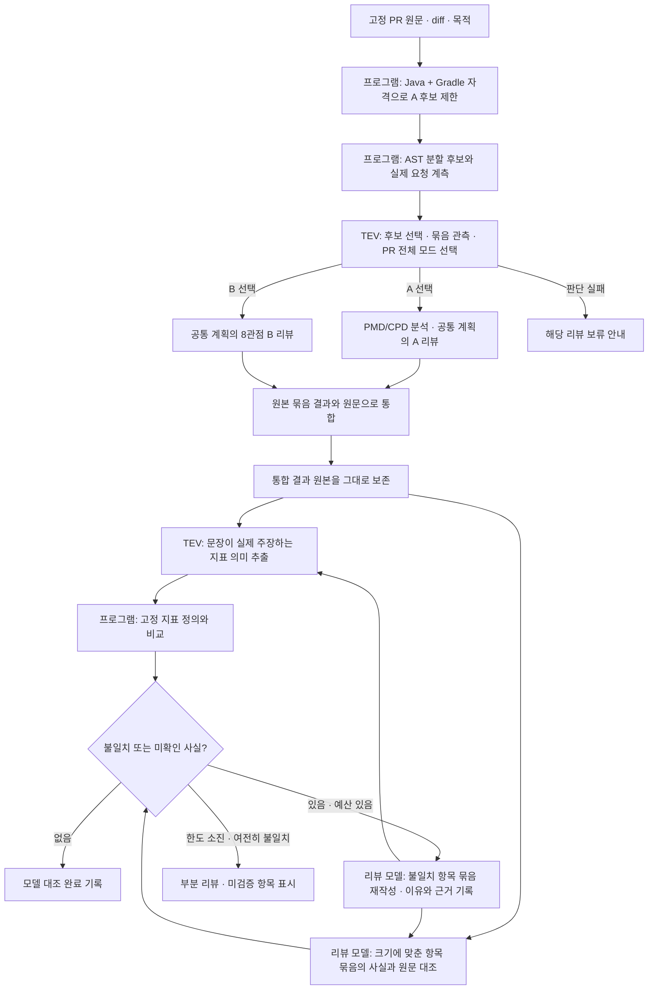

# 사실 검토와 재작성

## 크기 기준 묶음 처리

사실 확인과 재작성은 여러 항목을 고유 ID로 함께 처리한다. 완성된 요청의 native 입력 토큰과 출력 예약이
실제 프로필 한도에 들어가면 항목별 고정 호출을 만들지 않는다. 실제 초과일 때만 항목 또는 정확한 원문 범위를 나눈다.
원본 리뷰·모든 인용·원문·요청별 원시 응답을 보존하며 결과 조립은 ID로 수행한다.

단일 항목의 필수 근거도 초과하면 전체 원문의 페이지별 검토를 먼저 기록한다. 실제 인용과 원항목의 모든 인용을
정확한 원문 범위로 합친 뒤, 앞선 검사 결과와 변경 없는 항목으로 직접 whole-claim 사실검사를 다시 계측한다.
이 요청도 맞지 않거나 페이지 간 관계가 확인되지 않으면 미검증을 유지한다. 일부 페이지의 찬성이나 다수결로 승격하지 않는다.
분할한 재작성에서는 고정 후보를 다른 원문 페이지와 대조하고, 수정본은 다시 사실 확인해야 한다.

형식 오류·잘림·추가 근거·후보·재검사와 shared budget은 모두 같은 기록에 연결된다.
최종 검증이 일부라도 미완료면 해당 모드의 본문은 게시하지 않는다. 정상 완료된 다른 모드는 독립적으로 처리한다.

2026-10-21 사용자가 추가 승인한 공통 A/B 단계다. 기존 초기 계획·원문 분할·모드 선택·관점 리뷰·통합을 수행한 뒤, 최종 문장의 사실 오류를 검사하고 오류 항목을 재작성한다. PMD 리뷰와 의도 리뷰에 같은 단계가 적용된다.

## 입력과 검사의 경계

프로그램이 요약, 발견사항, 8관점, 질문에 안정적인 항목 ID를 부여한다. 각 항목의 원문 전체와 모든 `statement`, `reasoning`, `failure_condition`을 검사한다. 항목이나 긴 필드를 선별적으로 생략하지 않는다.

- **지표 정의:** TCC, ATFD, WMC, NPath, CognitiveComplexity의 의미를 PMD 7.3.0 기준으로 고정한다. [버전이 고정된 JavaMetrics 원문](https://github.com/pmd/pmd/blob/pmd_releases/7.3.0/pmd-java/src/main/java/net/sourceforge/pmd/lang/java/metrics/JavaMetrics.java)을 참조한다. 실제 측정값과 분석 한계는 이번 실행의 분석 대상 기록에서 제공한다.
- **TEV의 역할:** 정의를 맞히게 하지 않고, 리뷰 문장이 그 지표로 무엇을 주장하는지 지표별 선택지로 추출한다. 예를 들어 “TCC가 낮아 결합도가 심각하지 않다”는 `coupling`이다. 프로그램이 TCC의 정의인 `cohesion`과 비교해 불일치를 기록한다. 추출 자체는 모델 판단이다. 애매한 선택은 미확인으로 남긴다. 이름·숫자 목록만인 경우는 좁은 문법으로 식별하여 의미 분류를 생략한다. 목록의 측정값 대조는 여전히 수행한다. 실제 TEV 시험에서 숫자 목록만 보고 의미를 추정한 오답을 관찰했기 때문이다.
- **코드 사실:** 설정된 리뷰 모델이 고정된 원문과 실제 분석 자료에 대조하여 필드마다 `supported`, `contradicted`, `unverifiable`, `non_factual`을 기록한다. 여러 주장이 섞인 필드는 하나라도 틀리면 `contradicted`, 필요한 사실을 확인하지 못하면 `unverifiable`다. `supported`에는 원문 인용이 필요하다.
- **문장의 정확한 주장:** 조건의 AND/OR, 필요조건·충분조건, 기본값, 가능성과 보장을 구분한다. 여러 메서드를 함께 언급하면 각 메서드에서 그 속성을 확인한다. 한 메서드에만 있는 필터를 공통 동작으로 승인하거나, 잘못된 절을 더 약한 참 문장으로 바꿔 설명한 뒤 원문을 `supported`로 표시하지 않는다. 실제 오류 문장과 완전히 수정한 정상 대조 항목을 함께 사용하여 이 지시를 검증했다.
- **실행 사실:** 이 경로는 대상 테스트·빌드를 실행하지 않는다. 테스트 소스나 작성자의 실행 결과 주장을 봤다는 이유로 실제 테스트 통과나 운영 배포를 확인했다고 서술할 수 없다.

넓은 TEV 참·거짓 판정이 실제 TCC 오답을 통과시킨 관찰이 있으므로, 그 판정을 단독 품질 게이트로 사용하지 않는다. Bonsai의 원문 대조 역시 오판할 수 있다. `model_supported`는 이 검사 절차를 통과했다는 뜻이며, 의미적 정확성이 증명됐다는 뜻은 아니다. 고정 실제 PR의 독립적인 품질 평가는 별도로 수행한다.

## 원문 전달

각 실제 요청에 시스템 프롬프트, 스키마, 원본 항목, 사실 자료, 출력 예약을 포함하여 계측한다.

1. 전체 고정 원문을 그대로 제공하는 요청부터 검사한다.
2. 실제 초과일 때만 해당 항목이 인용한 원문의 전체 파일과 같은 경로의 변경 전후 원문으로 전환한다.
3. 그것도 실제 초과일 때만 모든 중첩 인용의 정확한 원문 바이트를 제공한다. 공통 PR 목적은 항상 전체를 보낸다.
4. 재작성에는 이전 검사 응답을 그대로 보내고, 그 응답의 모든 인용 바이트도 추가한다. 이전 완전한 원문 전달은 실행 기록에 남아 있다.
5. 단일 항목도 초과하면 전체 원문을 정확한 페이지로 나누어 검토한 기록을 보존하고, 실제 인용과 원항목의 모든 인용으로 전체 주장의 직접 재검증을 다시 계측한다. 끝까지 들어가지 않거나 관계가 확인되지 않으면 부분 리뷰로 남긴다. 문장·원문·인용을 요약하여 맞추거나 수집 범위를 확장하지 않는다.

## 재작성과 종료

집중 전달 요청에서 빠졌지만 고정 수집 범위에 있는 원문이 필요한 경우에는, 사실 검사 모델이 프로그램의 고정 목록에서 필요한 기존 원문 ID를 요청한다. 이미 완전히 전달한 원문은 후보에서 제외한다. 경로·검색어를 생성하거나 저장소를 추가 수집하지 않으며, 허용된 ID·중복·요청 사유·정보 부족 상태를 검증한다. 입력·원본 통합 결과·항목·검사 응답의 hash에 선택 계획을 연결한다. 이 단계는 최종 리뷰의 기존 고정 원문 요청 방식과 같다.

선택한 원문 전체는 같은 보정 회차의 재작성·재검사에 전달한다. 이전 검사 응답·항목·모든 인용 바이트를 보존하고 실제 계측 초과일 때만 집중 전달한다. 새 근거가 원래 문장을 뒷받침하면 원문 그대로 재확인할 수 있다. 예를 들어 수집한 테스트가 현재 요청에서 빠진 경우, 사실인 테스트 전제를 지우거나 임의로 통과시키지 않고 실제 테스트 원문으로 확인한다. 선택 이력·전달 범위·다음 검사로의 원문 상속을 저장 검증기가 다시 확인한다.

문제가 없는 항목은 그대로 유지한다. 문제가 있는 항목에만 완전한 수정본, 정정 이유와 원문 근거를 요청한다. 관점 ID, 대상 ID, 항목 개수는 유지한다. 근거 없는 발견사항은 이유를 명시한 `not_apply`로 바꿀 수 있지만 원본을 삭제하지 않는다. 변경된 항목은 지표 추출과 원문 대조를 모두 다시 거친다.

항목별 재작성 횟수는 기존 `max_rechecks`를 사용한다. 별도의 무제한 예산을 만들지 않는다. 기존 작업 마감, 호출·토큰 예산, 취소 fence와 모델 admission을 공유한다. 검사가 끝나기 전 예산·취소·모델·스키마 오류가 발생하면 마지막으로 받아들인 결과를 보존하고 `partial_review / factual_verification_incomplete`로 남긴다. 확인하지 않은 수정본을 최종 결과로 승격하지 않는다.

결과 schema 13와 prompt `partitioned-review/v17-shared-service-batched-facts`는 원본 통합 결과, 항목별 전체 후보·검사·재작성·재검사, 원문 범위, 실제 사용량을 보존한다. 저장 결과 검증기는 항목과 필드의 전수 대응, 지표 선택과 정의 비교, native 초과 후 전달 변경, 원본과 수정본의 결합을 다시 확인한다. A/B 비공개 산출물의 `fact-verification.json`과 `partition.json`에서 확인할 수 있다. 비공개 평가에서는 발행하지 않는다. 정상 GitHub App 경로는 검증이 완료된 결과만 개발자용 본문으로 게시하며, 미완료 상태에서는 보류 안내만 게시한다.

### Native 용량 거절과 사용량

Beam 전송에서는 반복된 JSON Schema 정의를 `$defs/$ref`로 공유한다. 확장한 스키마는 논리 스키마와 같으며 코드·근거·결과를 줄이지 않는다. 계측과 생성은 같은 전송 표현을 사용하고, 프로그램의 출력 필드·인용 검증은 원래 논리 계약을 유지한다.

native 계측 요청 자체가 한도를 넘으면, 완전히 수신한 HTTP400의 정확한 입력 수·고정 context·응답 형식을 확인한다. 해당 요청 슬롯만 해제하고 `partition.native_capacity_rejections`에 응답 원문·요청/wire hash·예약 근거를 보존한다. 실제 사용량은 unknown이며 `usage_complete=false`로 남는다. 별도의 `reserved_model_calls`와 `reserved_tokens`에 호출1회와 보고된 입력+출력 예약1토큰을 잡고, 이 예약을 모두 차감해도 예산이 남을 때만 기존 분할을 진행한다. 사용량을0으로 간주하지 않는다.

저장 검증기는 용량 증거·예약·단계 연결을 확인하며, 사실 확인 요청은 논리 입력으로 wire를 재구성하여 hash도 다시 검사한다. 다른 오류·불완전 응답·용량 근거 없는 unknown은 계속 중단한다. 용량 거절 후에도 모든 최종 항목의 사실 확인을 마쳐야 완료 본문을 게시할 수 있다.

전체 통합의 `retained`는 연결한 모든 결과가 원래 판정과 PMD/CPD 대상 집합을 유지할 때 사용한다. 판정이나 대상 집합을 바꾸면 같은 우려를 유지하더라도 `revised`로 기록한다. 문장과 인용 자체는 바꿀 수 있다. 모델 요청에도 프로그램 검증기와 같은 규칙을 명시하며, 이를 위반한 응답은 원본을 보존하고 제한된 정정 절차로 처리한다.

### 의도 관점의 적용 범위 확인

초기 TEV 관점 선택은 집중할 항목에 대한 가설이며 최종 verdict를 강제하지 않는다.
최종 의도 리뷰는 고정된 8관점을 모두 판단한다. `not_apply`에는 고정 관점 정의와 PR 원문에 근거한 범위 이유가 필요하다.
다른 관점에 집중한 페이지라는 설명이나 앞선 TEV 선택 자체는 제외 근거가 아니다.

기존 사실 확인 묶음에 perspective 항목이 있으면 프로그램이 고정 8관점 catalog와 이 scope policy를 함께 제공한다.
검사기는 statement·reasoning의 범위 전제를 원문과 대조하고, 근거 없는 제외 이유는 기존 재작성·재검사 경로로 보정한다.
정당한 `not_apply`는 유지하며, 초기 계획과 모든 이전 응답도 감사 원본으로 보존한다. A 전용 요청과 그 스키마·지침은 이 추가 문맥으로 바뀌지 않는다.

빈 원문 필드는 삭제하지 않는다. 사실 확인 응답은 해당 필드를 `non_factual`, 비어 있지 않은 이유, 빈 인용 배열로 표시해야 하며, 잘못된 응답을 프로그램이 자동 정규화하거나 검증 조건을 완화하지 않는다.

### 최종 항목 인용과 사실 확인 근거의 연결

사실인 문장도 최종 항목의 인용이 해당 내용을 보여 주지 않으면 보정 대상이다.
검사 모델은 전체 고정 원문에서 문장의 참·거짓을 확인하는 동시에, 원래 항목의 인용 범위가 그 주장을 직접 뒷받침하는지도 확인한다.
다른 줄에 근거가 있다는 이유로 원래 항목을 그대로 승인하지 않는다. 문장이 원문에 부합하면 내용을 유지하면서 인용을 정정한다.

프로그램은 비어 있지 않은 factual 필드의 `supported` 판정에서, 검사 모델이 제시한 근거 범위가 원래 항목 인용의 동일 원문 범위 합집합 안에 포함되는지 보수적으로 확인한다.
범위가 다르면 문장이 거짓이라고 단정하지 않고, 현재 인용 연결로 지원 판정을 확인하지 못했다는 미확인 사유를 기존 항목 재작성·재검사에 전달한다.
요약처럼 자체 인용이 없는 항목과 `non_factual`·빈 필드에는 이 포함 검사를 적용하지 않는다.
범위 포함 자체는 코드 의미를 증명하지 않으며, 정확한 줄을 과도하게 넓은 범위로 인용한 경우에도 재검토가 필요할 수 있다.

원래 문장·인용·모델의 원시 `supported` 응답을 변경하지 않고, 프로그램의 추가 사유를 별도로 기록한다.
새 모델 단계나 무제한 재시도를 추가하지 않으며, 수정본의 실제 인용으로 다시 확인해야 최종 본문에 사용할 수 있다.
저장 결과 재검증도 같은 범위 비교를 수행한다.

사실 확인 요청은 각 항목의 기존 인용 범위 안에서 선택할 수 있는 `original_support_reference_ids`를 명시한다.
`supported` 판정의 근거는 이 후보에서 선택하고, 다른 범위가 필요하면 미확인 또는 모순의 근거로 제시한다.
동등한 HEAD·diff 가운데 검사 모델이 불필요하게 다른 ID를 골라 보수적 범위 검사에 걸리는 경우를 줄이기 위한 입력 계약이다.
원본 항목의 인용이 실제로 주장을 뒷받침하는지에 대한 의미 판단은 여전히 필요하다.
프로그램의 인용 연결 사유만 있고 원래 사실 판정이 모두 지원·비사실인 경우, 재작성은 기존 문장과 판정을 유지하고 인용을 보정하도록 지시한다.

### PMD 신호의 소유자와 재작성 조건

PMD 수치와 메시지는 실제 경로·클래스·메서드에 연결한다. 같은 인용 조각에 두 메서드가 있어도 한쪽의 수치를 다른 쪽에 귀속하지 않는다.
새 정적 분석 신호가 생겼다는 사실은 새 클래스가 추가됐다는 뜻이 아니며, 클래스·메서드 추가 여부는 변경 전후 원문으로 확인한다.
PR 설명에서 범위 밖이라고 적힌 기능도 실제 제공 코드에는 존재할 수 있다.

재작성에도 기존 지적의 계약을 전달한다. `concern`에는 구체적인 발생 조건과 변경 후 코드의 인용이 필요하다.
조건 없는 `improvement`를 조건 없는 `concern`으로 바꾼 응답은 기존 검증기가 거부한다.
한국어 TCC 의미 추출은 실제 문장에 서술된 응집도와 결합도를 한국어 질문·닫힌 선택지로 구분한다.
영문 지표 선택과 다른 지표의 추출 계약은 유지한다.

각 분석 대상의 `base_findings`와 `head_findings`는 원래 PMD/CPD dataclass를 전체 복사한다.
PMD의 rule·ruleset·class·method·message·행·열·fragment, CPD의 token 수·occurrences·fragment를 유지한다.
집계 수치와 위치만 전달하고 메서드 소유자를 모델이 다시 추정하게 하지 않는다.
이 고정 메타데이터는 묶음 생성·최종 통합·사실 검사·재작성에서 공통으로 사용하며, 원래 signal evidence도 함께 보존한다.
클래스 수준 신호의 빈 method는 채우지 않고, 원래 메시지와 소유 범위가 없는 값은 추정하지 않는다.

PMD 검토의 문맥 전용 페이지도 A 모드를 유지한다. 모든 A 최종 페이지와 전체 통합의 `perspectives`는 빈 배열이며,
분석 대상이 없는 페이지의 `findings`와 `target_reviews`도 비운다. B의 8관점 항목 정의를 A의 빈 배열 스키마에 포함하지 않는다.
모드를 섞은 응답에는 기대 개수 0과 실제 개수를 명확히 전달하여 기존 1회 정정 절차로 처리하며, 응답을 자동으로 빈 배열로 바꾸지 않는다.
